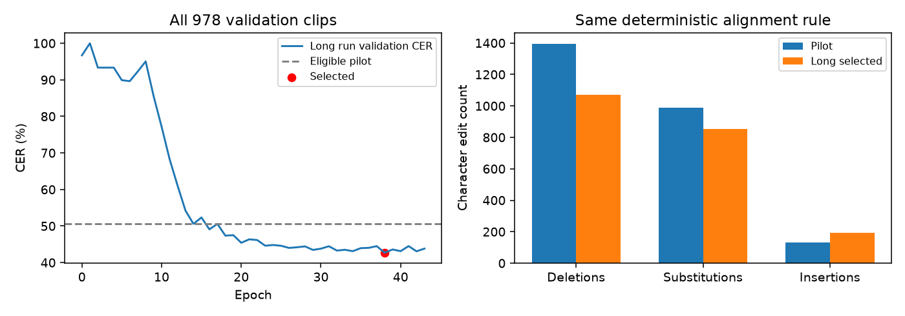

# GRU + CTC longer-budget experiment — 2026-11-21

Selected **long**, epoch **38**. Validation CER: **50.5939% → 42.7018%**.

## Pre-training diagnosis

Pilot numbers independently reconstructed from CSV and raw logits: 978 clips, 4,967 target characters, 3,703 emitted characters, 2,513 edits, 110 exact transcripts, 35 empty outputs. Edit allocation: 1,395 deletions, 987 substitutions, 131 insertions. J/Z/Q/space had zero frame-argmax occurrences, before greedy decoding.

Blank is index 0 and literal space index 27. Synthetic logits successfully decode all 26 letters plus space, jazz, all, a b, leading/trailing and consecutive spaces. No mapping/decoder bug was found, so no model, feature, decoder or optimization fix was made.

## Controlled experiment

One longer run from random initialization, not warm-started from pilot weights. Only max_epochs 15→60 and loop budget 600→900 seconds changed. Seed 42, Adam lr=0.001, batch 32, dropout 0.1, patience 5, full temporal resolution, architecture, features, clip memberships, gradient clipping and greedy decoding are identical. No augmentation, class balancing or scheduler. The same training-only debug protocol ran before an independent seed reset; its weights were not used.

Original pilot remains eligible. Final selection takes minimum validation CER across the longer run (including epoch 0) and the pilot; ties retain the pilot. Patience within the longer run retains the original run-local definition. Neither test predictions nor test-based parameter choices were made.

Reproducibility: 16 shared epoch records (including epoch 0); exact metric/loss agreement: True. See reproducibility.json.

Executed epochs: 43; time budget reached: False. Successful training invocation: 473.69 seconds; peak process RSS 622.39 MiB. Elapsed invocation includes setup/debug/final scoring outside the loop budget.

## Text metrics

| Split / model | CER | Exact | Empty | Deletions | Substitutions | Insertions | Output characters |
|---|---:|---:|---:|---:|---:|---:|---:|
| Validation / pilot | 50.5939% | 110/978 | 35/978 | 1395 | 987 | 131 | 3703 |
| Validation / selected | 42.7018% | 170/978 | 17/978 | 1072 | 855 | 194 | 4089 |
| Training / pilot | 49.3333% | 803/5433 | 299/5433 | 9047 | 4482 | 567 | 20093 |
| Training / selected | 28.9119% | 2210/5433 | 121/5433 | 5620 | 2217 | 424 | 23377 |

Training metrics are not held-out performance. All 978 validation clips remain in CER/exact/empty metrics. Finite target-length-normalized CTC loss uses the 976 alignable validation clips; emmett (7<8) and all (3<4) remain in text metrics. zero_infinity=False; no target-dependent stretching.

## Validation J/Z/Q/space

| Symbol | Target occurrences | Pilot emitted | Selected emitted | Selected aligned correct | Selected frame argmax |
|---|---:|---:|---:|---:|---:|
| J | 16 | 0 | 4 | 4 | 5 |
| Z | 19 | 0 | 3 | 0 | 3 |
| Q | 4 | 0 | 0 | 0 | 0 |
| space | 193 | 0 | 3 | 3 | 3 |

Emitting a symbol does not prove correct recognition. Aligned-correct counts refer to transcript matching under the specified tie rule, not isolated gesture recognition or verified frame alignment.

## Edit alignment rule

Unit-cost Levenshtein DP; traceback from the end prefers equal diagonal match, then diagonal substitution, then reference deletion, then hypothesis insertion. Counts on ambiguous alignments depend on this deterministic rule.

The overall Levenshtein distance is invariant to ties; substitution/deletion/insertion allocations and per-symbol correct counts can vary. Both models use the same rule. The output-length difference equals insertions minus deletions.

## Files and reproduction

- comparison.json/csv: both training and validation metrics.
- pilot_diagnostic/ and long_diagnostic/: per-clip edit counts and pre-decoder argmax counts.
- training_edits.* and pilot_training_edits.*: all training clip edit counts.
- validation_predictions.* and training_predictions.*: raw transcripts and local unpadded logits.
- candidate_report.json: unmodified result of the longer run before pilot eligibility comparison.
- history.json/config.json/source_hashes.json/vocabulary.json: original trainer outputs.
- protected_inputs_sha256.json: pre-run hashes of static/pilot/recording files.

Selected checkpoint: models/sequence/gru_ctc_long_v1.pt
SHA-256: 762d11636d38f35ae8590fbef6bfb9edd2687b5f0acdd5c027dba063146973fc
Pilot SHA-256: 6dfa215d59bc7f614e9bf89d442ef274ae1aa1f092733c2ce073fe987c680031

Commands (fresh result/checkpoint paths required for a new run):

    .venv/bin/python scripts/train_ctc.py --epochs 60 --seconds 900 --output results/sequence/gru_ctc_long_v1 --checkpoint models/sequence/gru_ctc_long_v1.pt
    .venv/bin/python scripts/compare_ctc_runs.py

Validation was used for selection, not an independent final test. The same conversion/hand-order/aspect/FPS unknowns apply as in the pilot. This is an offline segmented-sequence experiment, with no new live or test claim.

Stopping reason: patience=5 early stopping. All 375 protected files unchanged.

Selected validation CTC loss: 1.75283041, denominator 976.

Verification: **63 tests passed**, including synthetic full-vocabulary logits,
blank/space/repeat preservation, deterministic edit ties and emitted-but-wrong
symbols. Ruff and git diff --check passed. The training script reloaded the
selected checkpoint for final inference; diagnostics independently reconstructed
all 978 transcripts from saved logits. Source hashes and all protected files
are unchanged. The first 16 shared epoch records match exactly, not merely
within numerical tolerance.

Final verification completed on 2026-11-22 (Asia/Kuala_Lumpur); the experiment
entry retains its 2026-11-21 start date.
