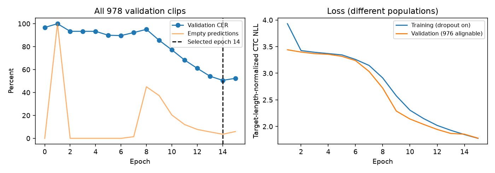

# ChicagoFSWild GRU + CTC: first offline pilot — 2026-11-21

**Selected epoch 14 of 15. Validation CER 50.5939%, exact transcripts 110/978 (11.2474%), empty outputs 35/978 (3.5787%).** This is a feasibility baseline, not a usable live recognizer or evidence that the project bonus is complete. The static model remains the approved live reference.

## Data and provenance

Sources: [original TTIC release](https://home.ttic.edu/~klivescu/ChicagoFSWild.htm) and [community conversion](https://huggingface.co/datasets/Kibalama/ChicagoFSWild-Landmarks), pinned revision c738cce88fcae8bcdb0811738c44a0b41701ad4d.

Downloaded and hash-verified exactly 414,214,372 Parquet bytes plus a 1,048,576-byte archive prefix. The original 14-GB video archive was not downloaded. All 30 supplied bundle files matched FILES_SHA256.json. The loader matched every train/validation ID, unchanged label, frame count and full float64 hand fingerprint against the pinned audit. Metadata checks confirm signer/ID/exact sequence separation. Test payload was downloaded and hashed only: the development loader refuses test, and no test predictions were generated.

| Split | Scoped sequences | Signers | Frames | Missing-hand frames | J clips | Z clips |
|---|---:|---:|---:|---:|---:|---:|
| train | 5433 | 87 | 150368 | 2596 | 133 | 72 |
| validation | 978 | 37 | 27772 | 414 | 15 | 18 |
| test | 867 | 36 | 25950 | 317 | 30 | 8 |

Membership remains the supplied fixed pilot: whole punctuation-containing clips excluded, plus 18 entirely hand-empty training clips. No symbols were stripped. Vocabulary is literal lowercase a–z and space (indices 1–27); CTC blank is 0. No digits or uppercase outputs. The test row is audit metadata only, not an evaluation.

## Input and architecture

Feature version: sequence-unordered-hand-shape-wrist-scale-v1. Preserve every stored frame. Each 21-point block supplies 63 wrist-relative coordinates divided by maximum 3D point radius, raw point-0 xyz, and log radius (67 values). Point 0 is assumed to be the wrist; the converter did not document anatomical ordering. Scale floor: 1e-6. No coordinate clipping, image-aspect correction or left/right mirror flip. A 42-point frame is treated as two unordered 21-point blocks, without anatomical hand names.

Shared hand MLP 67→96→64, ReLU; masked mean and max pooling plus count/2 produce 129 frame features. Missing blocks cannot contribute; an entirely missing frame has a zero embedding but still advances the sequence. Raw global point-0 position and scale remain, retaining motion information that centering alone would remove. Set pooling sacrifices explicit cross-frame hand identity.

Two-layer causal GRU, hidden size 128, dropout 0.1 between layers; linear 28-class CTC head. **214,876 parameters**, trained from random initialization. Variable lengths are packed; full time resolution retained. No pretrained recognition or static weights imported. Greedy CTC decoding only: adjacent duplicate tokens collapse unless separated by blank. No language model, beam search or live word builder.

## Debugging before the pilot

Four attempts on the first 16 shortest unique training labels stalled at 14/16 (CER 4.6512%): 600 and 3,000 steps with seed 42, then 1,500 steps with seed 7, then 1,500 with a temporary initial blank bias of 2. The bias change did not resolve the errors and was removed. Failed targets were asl→sl and law→saw; both have leading missing frames. This suggests alignment/optimization difficulty but does not prove its cause.

For an isolated learning-path check, the final fixed debug selection additionally requires a hand in the first frame. It uses the first 16 distinct labels sorted by frame count/ID, 10–35 frames, 2–5 target characters. This restriction applies only to debug, not full training/validation. Seed 7, Adam lr=0.003, dropout disabled: **16/16, CER 0 at step 700**. Debug IDs, predictions, logits and prior attempts remain saved. This is memorization, not generalization. The pilot resets seed 42 and starts from independent random weights.

## Configuration and selection

CPU, four Torch threads, deterministic algorithms, seed 42, batch size 32; Adam lr=0.001, no weight decay, gradient clipping at 5.0, no augmentation. Bound: 15 epochs, 600 seconds for the pilot loop, patience five epochs without lower validation CER. All 15 epochs completed. Setup, debug and final scoring are outside the loop budget.

Selection is micro character error rate: total Levenshtein edits divided by all 4,967 validation target characters, including spaces. Epoch 0 participates. Epoch 15 has more exact transcripts (112), but worse CER (52.3455%) than epoch 14, so it was not selected.

Both unalignable validation clips remain in CER/exact/empty metrics: emmett (7 frames, minimum 8) and all (3 frames, minimum 4). Finite CTC loss is separately reported over **976** clips, excluding exactly those two. Loss is mean per-clip NLL divided by target length. zero_infinity=False; nonfinite losses raise. No target-dependent stretching or temporal downsampling.

## Measured results

| Group | CER | Exact transcripts | Empty outputs |
|---|---:|---:|---:|
| Training (not held out) | 49.3333% | 803/5433 | 299/5433 |
| Validation (selection set) | 50.5939% | 110/978 | 35/978 |
| Validation containing J | 62.5000% | 0/15 | 0/15 |
| Validation containing Z | 56.6176% | 0/18 | 0/18 |

Validation CTC loss: 1.85563429 over 976 clips. Initial validation CER: 96.6982%. J/Z subset CER measures entire transcripts, not isolated-letter recognition. Neither subset contains a fully correct transcript; samples of 15 and 18 limit conclusions.

Successful invocation elapsed: 178.87 s, including setup/debug/final scoring; pilot phase including final scoring: 161.22 s. Peak process RSS: 595,312,640 bytes (567.73 MiB). Earlier debug optimization attempts added 51.03 s, excluding their setup. Download time is not included. These are offline compute measurements, not live latency.

## Artifacts and reproduction

- report.json, config.json, vocabulary.json, scope.json, source_hashes.json, implementation_sha256.json.
- history.json and learning_history.csv distinguish training loss from validation metrics.
- validation_predictions.csv/json preserve all 978 target/prediction pairs; validation_predictions_logits.npz stores concatenated unpadded logits, lengths and IDs (local/Git-ignored).
- debug_attempts.json links the four unsuccessful attempts; debug_predictions.* preserves successful subset outputs.
- Checkpoint: models/sequence/gru_ctc_pilot_v1.pt (local/Git-ignored).

Checkpoint SHA-256: 6dfa215d59bc7f614e9bf89d442ef274ae1aa1f092733c2ce073fe987c680031

Commands from the project root (existing CPU Torch environment):

    .venv/bin/python -m pip install -r requirements-sequence.txt
    .venv/bin/python asl_sequence_audit/fetch_data.py --cache-dir data/external/chicagofswild
    .venv/bin/python scripts/train_ctc.py --debug-steps 1500 --output results/sequence/gru_ctc_reproduction --checkpoint models/sequence/gru_ctc_reproduction.pt

Training refuses to overwrite prior results/checkpoints. Explicit debug-steps=1500 used for this run is now also the default. The pinned audit snapshot is excluded from repository Ruff formatting to preserve its hashes; its own 11 tests pass.

## Limitations and next milestone

Validation is used for selection, not an independent final test. Test remains unused for inference. Conversion hand order, tracker version, resizing/mirroring, chronology and FPS are undocumented. Original dimensions do not establish conversion coordinate units. This preprocessing is experimental and not camera-compatible by assumption. Exact hashes do not rule out similar performances.

The pilot establishes an executable learning pipeline, but only 11.25% exact transcripts. It is not a deployment candidate. Further offline decisions must remain train/validation-only. A distinct streaming experiment must verify tracker compatibility, unsegmented whole-word accuracy, state/reset handling and output delay before any live claim. Additional gestures/digits remain outside this dataset.

Verification: 60 repository tests plus 11 supplied audit tests passed. Ruff and git diff --check passed. The checkpoint was reloaded before final validation scoring. Protected static/recording hashes are verified separately in integrity.json.

Final integrity check: all **318** protected static/data files are unchanged.
All 978 persisted transcripts were reproduced from their raw logits. A trained
checkpoint hand-block swap preserved the decoded transcript; maximum logit
difference was 1.4305115e-6 (floating-point rounding), within atol=2e-6,
rtol=1e-5. This is numerical invariance, not a claim of bitwise identity.
The first exact-equality assertion was too strict for trained float32 CPU
matrix operations; no weights were altered to pass the tolerant check.
